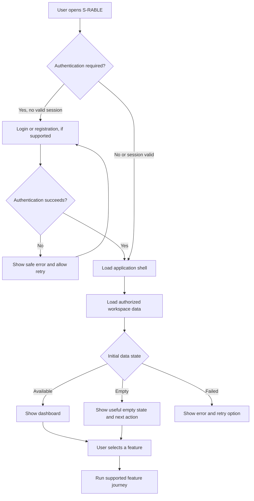
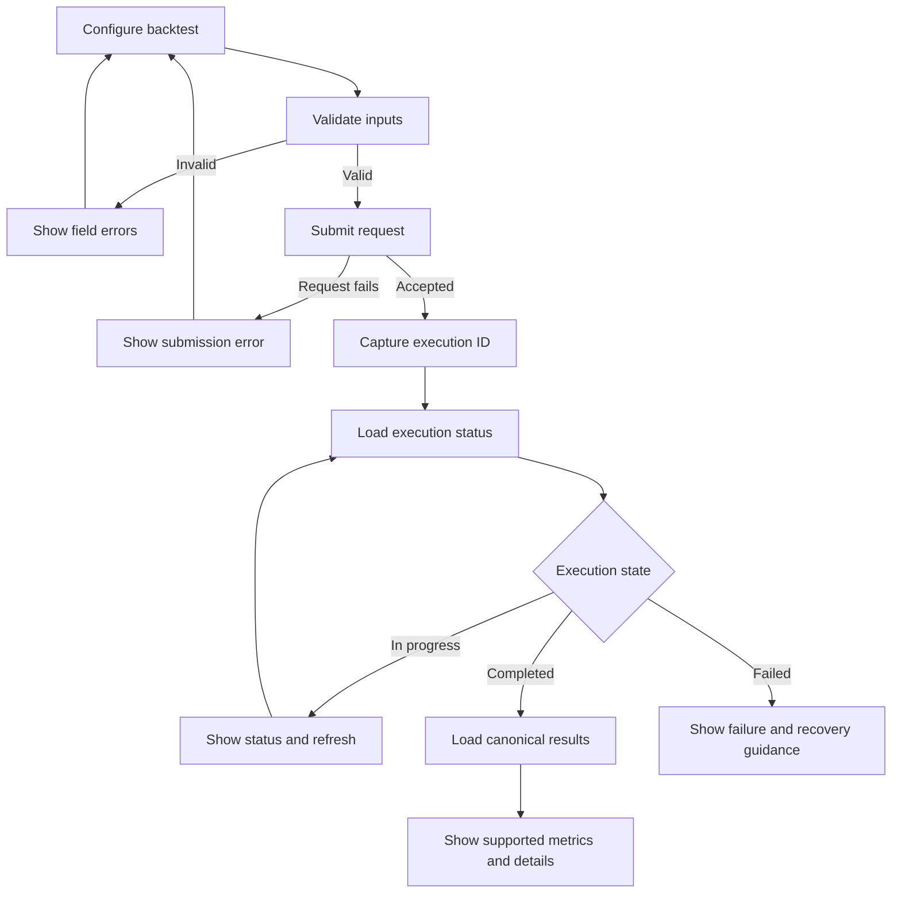

# S-RABLE — User Flow & UX Flow Specification

**Document type:** Product UX and user-journey source of truth  
**Status:** Initial baseline — validate against the current UI, API contracts, and product decisions  
**Applies to:** S-RABLE frontend and existing Python backend  
**Last updated:** 2026-10-14

---

## 1. Purpose

This document is the canonical overview of how a person is expected to move through S-RABLE, what the application should do at each step, and how it should respond to success, loading, empty, validation, error, and permission states.

Developers, designers, teammates, and future AI chats should start here to understand the intended user experience.

It describes proposed journeys, not a claim that every screen or backend capability already exists. Update this document when approved product behavior changes.

### Source-of-truth rule

This document is the canonical overview of intended user journeys. If a screen, implementation, or another document conflicts with it, record and resolve the discrepancy rather than silently choosing one version.

This document does not override backend behavior, API schemas, security rules, or approved product decisions. Unknown behavior is marked as pending verification.

---

## 2. How to interpret this document

- **[BACKEND-IDENTIFIED]** — A corresponding router or workflow was identified in the previous backend audit. This does not guarantee every operation is complete, secure, or ready for frontend use.
- **[PROPOSED UX]** — Recommended user experience, pending confirmation of requirements and API contracts.
- **[VERIFY]** — Must be checked against the current repository, API schema, or product owner.
- **[DEFERRED / UNAVAILABLE]** — Do not present as a working feature unless implementation is verified.
- **[SECURITY GATE]** — Must be verified before exposing the related operation.

A registered API router is not proof that every screen or end-to-end workflow exists. A proposed screen is not proof that the backend supports it.

---

## 3. UX principles

1. Make the next action clear.
2. Never present mock data as real account, market, portfolio, or backtest data.
3. Show the status of long-running operations.
4. Preserve safe user input after recoverable errors.
5. Explain errors in user-friendly language; keep technical details in safe logs.
6. Confirm destructive or consequential actions.
7. Enforce identity, authorization, and resource ownership on the backend.
8. Design loading, empty, validation, success, error, and permission states.
9. Do not imply unsupported capabilities.
10. Keep navigation, forms, tables, notifications, and status indicators consistent.

---

## 4. Product scope and capability map

The previous backend audit identified registered routers for:

- Authentication and users
- Brokers
- Strategies
- Instruments
- Executions
- Backtesting
- Orders
- Trades
- Positions
- Portfolio
- Notifications

The audit also reported that the market-data router was empty or not registered, and AI, health, and trading modules were empty or not registered at that time. Re-check the current repository before relying on those findings.

| Product area | UX treatment |
|---|---|
| Authentication and users | Core entry flow; verify exact supported operations |
| Strategies, instruments, and brokers | Resource-management journeys; verify schemas, actions, and permissions |
| Backtesting and executions | Core workflow: submit, track, and inspect results |
| Portfolio | Display only supported information; the previous audit described behavior as simulation-only, which must be re-verified |
| Orders, trades, and positions | Display supported records; do not imply live execution |
| Notifications | Show supported notifications and available actions |
| Market data | Pending confirmation of a real data source and API |
| AI capabilities | Not part of the initial flow until implemented and verified |
| Paper Trading (Phase 13) | Explicitly deferred |
| Live trading | Do not expose as operational without verified backend support and approved safeguards |

A registered router is not proof that a complete end-to-end feature exists.

---

## 5. Navigation and application shell

**[PROPOSED UX]** Primary navigation may include:

- Dashboard
- Strategies
- Instruments
- Brokers
- Backtests
- Executions
- Portfolio
- Orders
- Trades
- Positions
- Notifications
- Profile / Settings

Only show navigation entries for journeys that have a real, supported purpose.

### Navigation behavior

- The selected navigation item reflects the current route.
- Page titles and breadcrumbs, where used, identify the current location.
- Direct navigation to a protected page must enforce the same access checks as in-app navigation.
- Unknown routes show a not-found page with a safe route back to a known area.
- Refreshing a nested frontend route must work in production.
- Navigation is not an authorization mechanism; the backend remains responsible for authorization.

---

## 6. Global user journey

**[VERIFY]** Confirm whether registration, password recovery, token refresh, session persistence, and logout are implemented, and how authentication is transported.

---

## 7. Authentication and session flow

**[PROPOSED UX]**

1. The user opens the application.
2. The frontend determines session state using the actual backend authentication mechanism.
3. If authentication is required and the user is unauthenticated, show the login page.
4. The user enters credentials and submits the form.
5. The frontend validates required fields and submits the request.
6. On success, establish the session according to the backend's actual response and redirect to the intended destination, or the dashboard by default.
7. On failure, show a safe, understandable message and allow correction or retry.
8. On logout, clear frontend session state and call the backend logout operation if one exists.
9. If a session expires, request authentication again, avoid redirect loops, and preserve safe context where practical.

### Authentication UX and security requirements

- Never log passwords, tokens, or secrets.
- Do not expose tokens in URLs.
- Do not reveal whether an account exists unless the product's security design explicitly permits it.
- Do not redirect to a protected page without rechecking access.
- Make errors accessible to keyboard and screen-reader users.

**[VERIFY]** Exact authentication endpoints, request/response schemas, session storage, registration/recovery support, and authorization behavior.

---

## 8. Dashboard flow

### User goal

Understand the state of their workspace and choose a useful next action.

### Proposed journey

1. After successful entry, load the dashboard.
2. Fetch only summary information that the backend actually supports.
3. Show links or actions for supported workflows, such as managing strategies, starting a backtest, reviewing executions, or viewing portfolio data.
4. If the user has no relevant data, show a useful empty state and the next supported step.
5. If a summary request fails, identify the affected section and allow retry without breaking the whole application.

### UX requirements

- Do not invent performance metrics or market prices.
- Identify the meaning, units, and relevant time range of each metric.
- Distinguish unavailable data from a zero value.
- Show data freshness timestamps when the source provides them.
- A failed optional widget should not break the entire dashboard.

**[VERIFY]** Whether the backend has dedicated summary endpoints or the dashboard must compose supported responses.

---

## 9. Strategies flow

**[BACKEND-IDENTIFIED]** A strategies router was identified in the previous audit.

### Proposed journey

1. The user opens **Strategies**.
2. The page loads strategies available to that user.
3. The user searches, filters, sorts, or opens a strategy if supported.
4. To create or edit a strategy, the user opens a form containing backend-supported fields.
5. Frontend validation catches obvious input errors; backend validation remains authoritative.
6. On save, show success and refresh the relevant list or detail data.
7. On failure, preserve form values where safe and explain the next step.
8. For deletion or another consequential change, show confirmation if that action exists.

### States to support

- Loading list
- Empty list with a create action, if creation is supported
- List loaded
- Validation error
- Save in progress
- Save success
- Permission denied
- API or network error
- Missing or deleted strategy

**[VERIFY]** Strategy schema, supported CRUD operations, ownership controls, execution semantics, and whether strategies can be edited after being used in a backtest.

---

## 10. Instruments flow

**[BACKEND-IDENTIFIED]** An instruments router was identified in the previous audit.

### Proposed journey

1. The user opens **Instruments**.
2. The page loads supported instruments.
3. The user searches or filters using fields supported by the data model.
4. The user opens an instrument detail view if the API supports it.
5. Where backtest configuration requires an instrument, the user selects from verified available instruments rather than entering an unsupported identifier.

### UX requirements

- Distinguish instrument identity from price or market-data availability.
- Do not imply that instrument metadata means live or historical price data is available.
- Show a clear empty state when no instruments match the filters.

**[VERIFY]** Available fields, search/filter behavior, instrument detail endpoints, and the relationship between instruments and market data.

---

## 11. Brokers flow

**[BACKEND-IDENTIFIED]** A brokers router was identified in the previous audit.

### Proposed journey

1. The user opens **Brokers**.
2. The page shows broker configurations and supported status fields.
3. The user adds or edits a configuration only if those operations exist.
4. Request only credentials and settings required by the actual backend contract.
5. Validate the form and submit securely.
6. Display the returned configuration or connection state without exposing secret values.
7. Allow correction or retry if configuration fails.

### Security and UX gates

- Never display saved secrets in plain text.
- Never include credentials in logs, analytics, URLs, or error messages.
- Do not show a broker as connected unless the backend provides evidence of that state.
- A configured broker does not automatically mean live trading is supported.

**[VERIFY]** Supported providers, credential storage, connection-test operations, ownership, and whether integrations are operational or configuration-only.

---

## 12. Backtesting flow

**[BACKEND-IDENTIFIED]** Backtesting and execution routers were identified. The previous audit described `POST /backtests` as returning an execution response/job, with `GET /executions/{id}` used to retrieve execution status. Re-verify the current API schemas before implementation.

### User goal

Configure a backtest, submit it, monitor it, and understand the final result.

### Main journey

1. The user opens **Backtests**.
2. The user chooses a supported strategy and instrument, if required by the current API.
3. The user enters only parameters confirmed by the backend contract.
4. The frontend validates required fields and shows understandable inline errors.
5. The user reviews the configuration and submits the backtest.
6. While submission is in progress, prevent accidental duplicate submission where appropriate.
7. On successful submission, capture the returned execution/job identifier and navigate to a progress or detail view.
8. Retrieve execution status using the actual API response and an appropriate polling interval.
9. Show in-progress and terminal states only if supported by the backend.
10. When completed, fetch and display the canonical result response.
11. If the job fails, show safe failure information and a clear retry path.
12. If the browser refreshes or the user navigates away, allow them to recover the execution if the backend supports listing or retrieving it.

### Backtesting state flow

### Backtesting UX requirements

- Submission accepted is not the same as backtest completion.
- Stop polling when the execution reaches a terminal state or polling is no longer needed.
- Avoid duplicate jobs caused by repeated clicks or unclear loading behavior.
- Show a stable execution reference where useful.
- Do not invent progress percentages if the backend does not provide progress.
- Do not display zero metrics when results are missing.
- Distinguish “no trades occurred” from “results failed to load.”
- Render metrics and charts only from canonical backend results or documented, tested calculations.
- If cancellation is not supported, do not show a Cancel button.

**[VERIFY]** Request schema, accepted response, statuses, polling behavior, result schema, retry/idempotency behavior, cancellation support, and execution history endpoints.

---

## 13. Executions flow

**[BACKEND-IDENTIFIED]** An executions router was identified in the previous audit.

### Proposed journey

1. The user opens **Executions** or follows a backtest submission.
2. Load only executions the user is authorized to view.
3. Show supported identifying information and current status.
4. Allow the user to open an execution detail page if supported.
5. For active executions, refresh status at a reasonable interval or on user request.
6. For completed executions, link to associated results when available.
7. For failed executions, show safe error details and a supported recovery action.

**[VERIFY]** Execution listing, filtering, pagination, result links, and ownership.

---

## 14. Portfolio flow

**[BACKEND-IDENTIFIED]** A portfolio router and portfolio orchestration were identified. The previous audit described portfolio behavior as simulation-only; verify this against the current implementation before displaying specific claims.

### Proposed journey

1. The user opens **Portfolio**.
2. Fetch available portfolio information.
3. Display only metrics and breakdowns supported by the backend.
4. Provide links to related positions, trades, or orders where relationships are available.
5. If there is no portfolio data, explain the state and the supported next action.
6. If data cannot be loaded, distinguish the error from an empty portfolio.

### UX requirements

- Clearly label simulated or historical data.
- Never imply live account balances or live brokerage connectivity without verification.
- Document units, currency, and time range for monetary metrics.
- Do not derive financial metrics silently; document formulas and test calculations.

**[VERIFY]** Portfolio response schema, calculations, data source, refresh semantics, and whether multiple portfolios/accounts are supported.

---

## 15. Orders, trades, and positions flows

**[BACKEND-IDENTIFIED]** Routers for orders, trades, and positions were identified in the previous audit.

### Orders

1. The user opens **Orders**.
2. View supported order records and their backend-provided statuses.
3. Open an order detail view if supported.
4. Show order actions only when the backend supports them and the user's authorization permits them.
5. Confirm consequential actions and display the server's result.

### Trades

1. The user opens **Trades**.
2. View supported trade records.
3. Use backend-supported filters or date ranges.
4. Open trade details if supported.
5. Distinguish recorded historical trades from any claim of live execution.

### Positions

1. The user opens **Positions**.
2. View supported position records.
3. Show quantities, values, and profit/loss only when provided or calculated using documented rules.
4. Link to related instrument or trade details where relationships exist.

### Important boundary

A registered orders router is not proof that order placement, cancellation, or live brokerage execution is operational. The frontend must not expose such actions until the API, security model, and operational safeguards are verified.

---

## 16. Notifications flow

**[BACKEND-IDENTIFIED]** A notifications router was identified in the previous audit.

### Proposed journey

1. The user opens **Notifications** or a notification indicator.
2. Load notifications available to that user.
3. Show unread/read state if supported by the response.
4. Open a notification to view its content or navigate to a related resource when a safe link exists.
5. Mark as read or perform another action only if the backend supports it.
6. Show loading, empty, and error states.

**[VERIFY]** Unread counts, pagination, mark-read behavior, notification categories, and real-time delivery support. Do not promise push or WebSocket updates without a verified implementation.

---

## 17. Profile and settings flow

**[BACKEND-IDENTIFIED]** A users router was identified in the previous audit.

### Proposed journey

1. The user opens **Profile / Settings**.
2. Load the authenticated user's supported profile fields.
3. Display editable fields only where an update endpoint exists.
4. Validate and submit changes.
5. Show confirmation or actionable errors.
6. Require appropriate authentication or confirmation for sensitive changes if the backend supports them.

**[VERIFY]** User profile schema, update operations, password changes, preferences, and account deletion support.

---

## 18. Shared UX states and error behavior

Every API-backed page must implement the relevant states below.

| State | Expected user experience |
|---|---|
| Initial loading | Show a skeleton or clear loading indicator; avoid false empty states |
| Empty result | Explain that there is currently no data and show a supported next step |
| Filtered empty result | Explain that no records match the filters and allow clearing filters |
| Validation error | Associate messages with fields and preserve correctable values |
| Request in progress | Indicate progress and prevent accidental duplicate actions when necessary |
| Success | Confirm the outcome and update the relevant page/data |
| Recoverable API failure | Explain the problem and provide retry where appropriate |
| Authentication expired | Reauthenticate without entering a redirect/retry loop |
| Permission denied | Explain that access is unavailable without leaking protected data |
| Resource not found | Explain that the resource is missing or unavailable and offer safe navigation |
| Partial failure | Keep working sections usable and identify which section failed |
| Long-running operation | Show status and provide a way to return to the operation if supported |

### Error-handling rules

- Convert technical server errors into concise user-facing messages.
- Do not expose stack traces, SQL, secrets, internal filesystem paths, or sensitive identifiers.
- Log technical diagnostics safely without sensitive payloads.
- Retry only when safe; do not blindly retry non-idempotent write requests.
- If the backend returns a request/correlation ID, it may be shown for support.
- Avoid toast-only errors for problems that require action; place the message near the affected content.

---

## 19. Authentication, authorization, and ownership are release gates

The previous backend audit identified some CRUD routes that may lack route-level authenticated ownership controls. This is a finding to investigate, not proof that every such route is exploitable.

Before exposing a data operation in the frontend:

1. Verify authentication requirements.
2. Verify the backend checks authorization and record ownership.
3. Verify users cannot read, edit, or delete another user's resources by changing an ID.
4. Verify errors do not disclose another user's data.
5. Test the API directly; hiding a button or route in the frontend is not a security control.
6. Resolve and test any confirmed security issue before release.

The frontend must not be considered secure merely because its routes are protected.

---

## 20. Accessibility, responsiveness, and usability

Every implemented flow should follow these baseline rules:

- All primary actions are keyboard accessible.
- Forms have labels, understandable validation messages, and visible focus.
- Status changes are conveyed in accessible ways.
- Color is not the only way to distinguish success, failure, or status.
- Tables remain usable at narrower widths or have an intentional responsive alternative.
- Dialogs manage focus and can be closed according to accessible interaction patterns.
- Loading states do not cause avoidable layout shifts.
- Dates, times, quantities, percentages, and currencies have consistent formatting.
- Test keyboard navigation and responsive layouts for each complete journey.

---

## 21. Analytics and user tracking

No analytics platform or tracking behavior is established by this document.

If product analytics are later approved:

- Collect only necessary events.
- Never collect passwords, authentication tokens, broker credentials, or sensitive request payloads.
- Document events and retention.
- Respect applicable privacy requirements and user choices.

Do not add an analytics SDK simply because it is common in web applications.

---

## 22. Acceptance criteria for a complete user journey

A feature is not complete just because the page renders.

For each journey, verify:

- [ ] The user can reach the page through the agreed navigation.
- [ ] Direct URL access and refresh behave correctly.
- [ ] The page uses the verified API contract.
- [ ] Loading, empty, success, validation, error, and permission states are implemented where applicable.
- [ ] Duplicate or unsafe actions are handled appropriately.
- [ ] Authentication and ownership rules are enforced by the backend.
- [ ] No mock data is presented as real data.
- [ ] The flow is keyboard accessible and responsive.
- [ ] Component/unit tests cover important behavior.
- [ ] Critical end-to-end flows are tested in a browser.
- [ ] The implementation and any deviations are reflected in this document.

---

## 23. Open decisions required before calling the UX flow final

The following items must be verified or decided:

1. Exact authentication flow and session mechanism.
2. Whether registration, password recovery, and profile editing are supported.
3. Exact strategy and instrument CRUD operations and fields.
4. Broker configuration and connection-test capabilities.
5. Backtest request/response schema, statuses, result format, and polling rules.
6. Execution listing and history capabilities.
7. Portfolio data source and simulation-only boundaries.
8. Which order actions, if any, are actually supported.
9. Notification read state and delivery behavior.
10. Availability and source of market data.
11. Whether the dashboard has dedicated summary endpoints.
12. The final navigation labels and visual hierarchy.
13. Production static-file serving and client-side route fallback behavior.
14. Any confirmed backend authorization/ownership gaps affecting user journeys.

Resolve these through repository/API inspection and product decisions. Do not fill gaps by assumption.

---

## 24. Change-management rules

When a product or API change alters a user journey:

1. Update this document in the same change set as the relevant implementation, or explicitly link the follow-up issue.
2. State which journey changed and why.
3. Update the corresponding acceptance criteria and tests.
4. Mark a previously supported capability as unavailable if it stops working.
5. Keep the document aligned with the actual application rather than preserving obsolete flows.

Suggested owner: the person coordinating frontend integration. All three team members should flag inconsistencies between this specification and implementation.

---

## 25. Quick reference

- **General journey:** Open app → authenticate if required → load workspace → choose a supported feature → perform an action → see a result or recovery path.
- **Central workflow:** Configure a backtest → submit → capture execution ID → monitor status → inspect canonical results.
- **Core UX rule:** Every screen reflects real, authorized system state and handles loading, empty, error, and success conditions.
- **Scope rule:** A router does not prove a complete feature exists; verify the endpoint, schema, security, and operational behavior before exposing it.
- **Maintenance rule:** This is the canonical UX-flow overview and must evolve with the product.